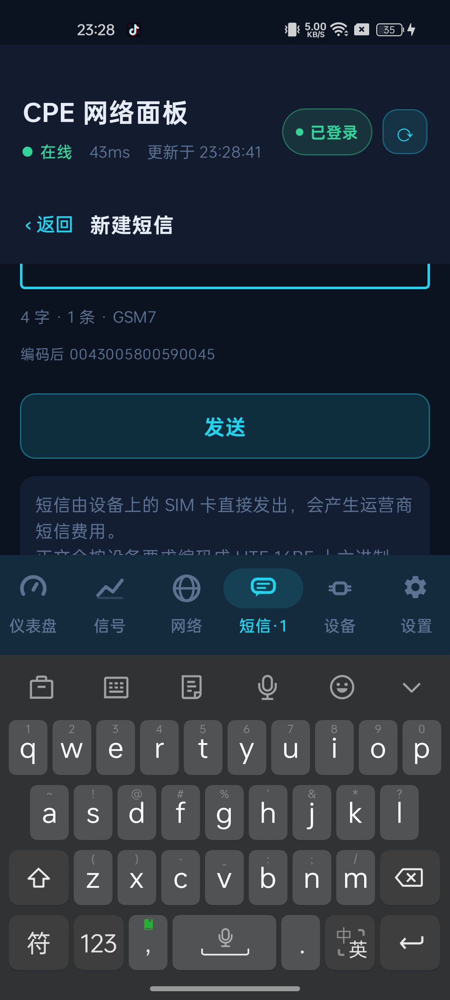
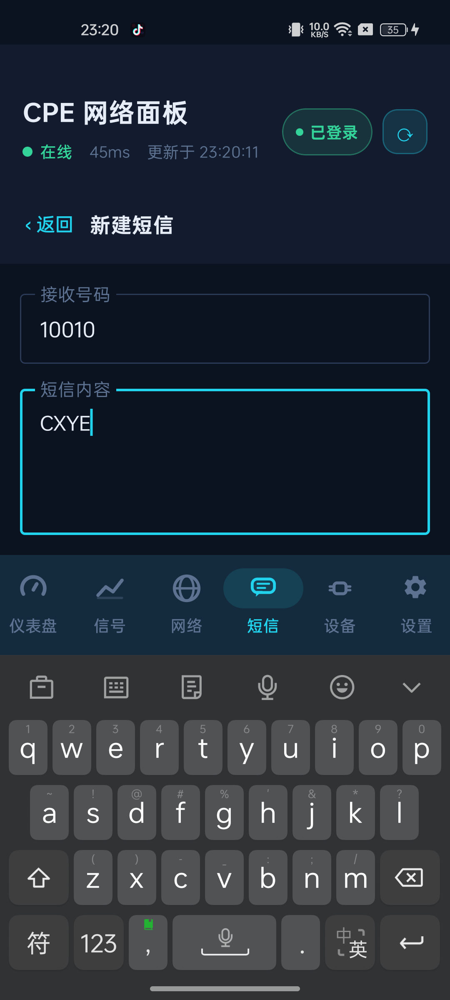
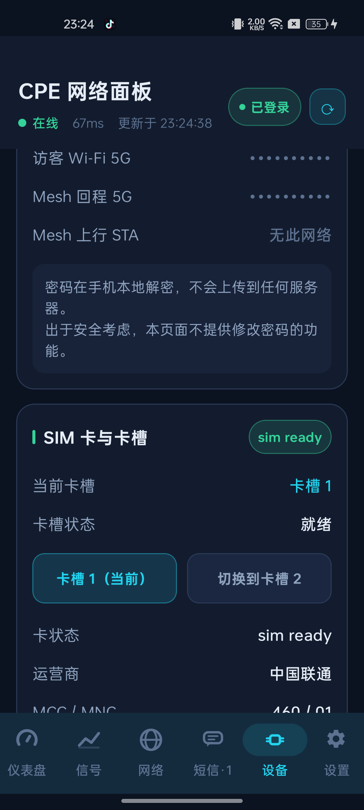
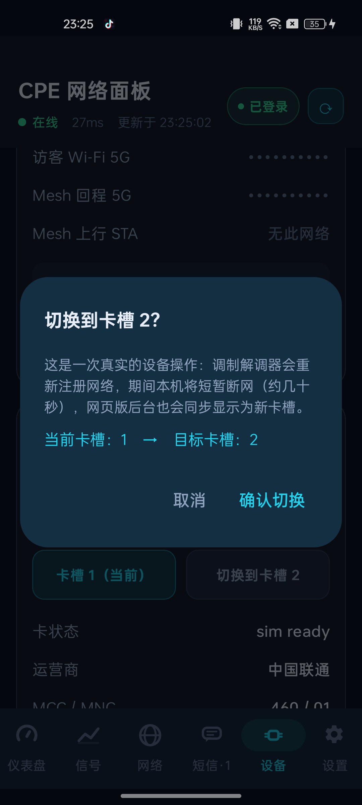

# CPE 网络面板 · CpePanel

> 把中兴 5G CPE 的网页版管理后台，装进 Android 手机里的原生 App。

[](https://developer.android.com)
[](https://kotlinlang.org)
[](https://developer.android.com/jetpack/compose)
[](LICENSE)

CpePanel 通过 CPE 本地管理后台的 `ubus` JSON-RPC 接口直接取数，
**不经过任何云端服务，不需要 Root，不需要改固件**。
所有数据在你的手机和你的 CPE 之间点对点流转。

---

## 目录

- [为什么做这个](#为什么做这个)
- [功能](#功能)
- [截图](#截图)
- [兼容性](#兼容性)
- [快速开始](#快速开始)
- [真机验证环境](#真机验证环境)
- [实测协议契约](#实测协议契约)
- [技术实现](#技术实现)
- [真机测试中发现并修复的缺陷](#真机测试中发现并修复的缺陷)
- [安全与隐私](#安全与隐私)
- [已知限制](#已知限制)
- [项目结构](#项目结构)
- [免责声明](#免责声明)
- [许可证](#许可证)

---

## 为什么做这个

中兴 5G CPE（MC8830 / G5TS 等）的网页版后台功能很全，但用起来不顺手：

- 手机上打开网页版要缩放、要拖拽，信号强度这种需要**反复看**的数据每次都要重新翻页；
- 看不到趋势 —— 网页只给你一个瞬时值，没有历史曲线；
- 短信、SIM 卡槽这类功能藏在菜单深处，点三四层才到。

CpePanel 把这些能力用原生 Compose 重写了一遍：**实时轮询、曲线趋势、一屏看懂、写操作一步一确认**。

---

## 功能

底部 6 个标签页，共对接 **61 个 ubus 接口**（56 个只读 + 5 个写操作）。

### 仪表盘
- 网络状态、运营商、连接时长、上下行实时速率
- 信号强度实时曲线（RSRP / SINR / RSRQ / RSSI 采样趋势）
- 流量统计、设备摘要

### 信号
- 5G NR / LTE 小区信息（频段、带宽、PCI、TAC、小区 ID）
- 邻区列表（NR 邻区、LTE 邻区）
- 信号质量评级与 SNR 分布
- 服务小区与邻区的对比视图

### 网络
- WAN 状态、拨号方式、IPv4 / IPv6 地址、DNS
- 连接设备列表与在线状态
- APN 配置（自动 / 手动模式、AT CID）
- Wi-Fi 报告（频段、信道、速率）

### 设备
- 设备型号、固件版本、运行时长、温度
- **SIM 卡与卡槽**：当前卡槽、卡槽状态、运营商、MCC / MNC、调制解调器状态
- **卡槽切换**：带二次确认，切换后轮询回读设备**真实卡槽**（详见下文）
- Wi-Fi 密钥本地解密查看（AES-256-CBC，密钥不出手机）
- 短信元信息：总量、未读数、会话数、设备容量、SIM 容量、短信中心号

### 短信
- **会话列表**：按号码聚合，显示最新一条与时间，未读 / 已发送 / 失败 / 草稿用不同颜色区分
- **会话详情**：聊天气泡视图，区分收发，底部直接回复
- **发送短信**：正文按设备要求编码为 UTF-16BE 十六进制，自动判定 GSM7 / UCS2，
  实时显示字数、条数（GSM7 单条 160 字 / 中文单条 70 字）与编码结果预览
- **删除短信**：支持删除整个会话，二次确认并明确提示「直接作用于设备，无法撤销」
- 所有写操作**一步一确认，不做任何自动重试** —— 避免一次点击发出多条短信

### 设置
- CPE 地址配置、刷新频率、加密协商开关
- 登录 / 登出、会话状态
- 接口清单与调试信息

---

## 截图

| 新建短信（键盘弹起，发送按钮可达） | 新建短信（编码预览） |
| :---: | :---: |
|  |  |

| SIM 卡与卡槽 | 切卡二次确认 |
| :---: | :---: |
|  |  |

> 含个人短信正文与手机号的截图未随仓库发布。完整的真机验证结论见
> [docs/verification-report.html](docs/verification-report.html)（已脱敏）。

---

## 兼容性

| 项目 | 说明 |
| --- | --- |
| 目标设备 | 中兴 MC8830 / G5TS（5G CPE，OpenWrt 底层） |
| 管理地址 | `http://192.168.0.1`（可在设置中改为任意地址或端口） |
| 通信协议 | `ubus` JSON-RPC 2.0 over HTTP |
| 理论上兼容 | 其他采用同款 Web 框架的中兴 CPE（如 MC801A 等），**未实测** |
| Android | 最低 8.0（API 26），目标 14（API 34） |

不在兼容列表里的设备也可能能用：直接在设置里填管理地址，先在「仪表盘」看看有没有数据回来。

---

## 快速开始

### 方式一：直接安装

下载 [Releases](../../releases) 或本仓库 `apk/` 目录下的 APK，安装后：

1. 手机连上 CPE 的 Wi-Fi；
2. 打开 App，右上角点「未登录」；
3. 输入 CPE 的**管理密码**（就是网页版登录用的那个）；
4. 开始使用。

### 方式二：自行构建

需要 JDK 17 与 Android SDK（`compileSdk = 34`）。

```bash
git clone https://github.com/<your-name>/CpePanel.git
cd CpePanel
./gradlew assembleDebug          # 产物：app/build/outputs/apk/debug/app-debug.apk
```

Windows 下用 `gradlew.bat`。首次构建会自动下载 Gradle 8.7 与依赖。
若本地已有 SDK，记得在 `local.properties` 里写 `sdk.dir=/path/to/android-sdk`（该文件已被 gitignore）。

---

## 真机验证环境

本项目所有结论均来自真机实测，未使用模拟器或桩数据。

| 项目 | 值 |
| --- | --- |
| 被测设备（CPE） | 中兴 MC8830 / G5TS · 5G CPE（OpenWrt 底层） |
| 管理入口 | `http://192.168.0.1` |
| 测试终端 | OPPO PGAM10 · Android 14 · 1080 × 2400 |
| 调试通道 | adb（序列号 `4c93****`） |
| 网络运营商 | 中国联通（MCC / MNC 460 / 01） |
| 验证时间 | 2026-09-13 |
| 接口覆盖 | 61 个可用接口（56 只读 + 5 写） |
| 交付 APK | 9,230,527 字节 · SHA-256 `aeb493fc3dac3394ef144358a12c354c5c54d5f6947245cdadc64cab545a2970` |

验证范围：

- 46 个需登录接口 + 7 个免登录接口逐条调用核对；
- 180 秒持续轮询稳定性测试，0 失败；
- 短信链路端到端闭环：App 发出 → 设备 SIM 实际发出 → 运营商回执到达 → App 内可查看、可删除；
- SIM 卡槽切换：幂等调用被设备受理 + 界面与二次确认流程完整（**未执行真实跨卡槽切换**，见[已知限制](#已知限制)）。

详细证据与截图见 [docs/verification-report.html](docs/verification-report.html)。

---

## 实测协议契约

以下返回值为**真机上逐条打出来**的结果，不是从文档或前端代码推断的。
在对接这类封闭设备时，第一手契约比任何文档都可靠 —— 网页前端的行为和后端的实际实现经常不一致。

### 读接口

| 接口 | 契约 |
| --- | --- |
| `zwrt_wms` · `zte_libwms_get_sms_data` | 参数 `{page:0, data_per_page:500, mem_store:1, tags:10, order_by:"order by id desc"}`；返回数组键为 `messages`；单条字段 `id / number / content / date / tag / mem_store / draft_group_id`；`content` 是 **UTF-16BE 十六进制**；时间字段是 `date`；`tags` 传 0 会返回空列表 |
| `zwrt_wms` · `zwrt_wms_get_cmd_status` | 参数 `{sms_cmd:N}`（1=就绪检测、4=发送、5=存草稿、6=删除），返回 `sms_cmd_status_result`：3=成功、2=失败、其它=进行中。**注意：该值在设备空闲时也会残留为 3**，不能单独当成功依据 |
| `zwrt_zte_mdm.api` · `get_sim_info_before` | 提供 `current_sim_slot`、`switch_card_status`、`sim_states`、`Operator` 等真实卡槽信息 |

**易错点**：短信的 ubus 对象名是 `zwrt_wms`，**不是 `zte_libwms`** —— 后者会返回 `-32000 Object not found`。

### 写接口

| 接口 | 契约 |
| --- | --- |
| `zwrt_wms` · `zte_libwms_send_sms` | 参数 `{number, sms_time, message_body, id, encode_type}`。成功返回 `{"result":3}`，失败（如号码为空）返回 `{"result":2}`。`id` 必须是**字符串** `"-1"` —— 传数字 `0` 直接报 `status 2`；缺 `id` 或 `encode_type` 同样 `status 2`。`message_body` 为正文的 UTF-16BE 大写十六进制 |
| `zwrt_wms` · `zwrt_wms_delete_sms` | 参数 `{"id":"3;5;9;"}` —— 分号连接且**末尾必须带分号**；缺末尾分号返回 `{"result":2}`。成功 `{"result":3}` |
| `zwrt_zte_mdm.api` · `sim_switch_slot` | 参数 `{"slot":1｜2}`。**受理时响应体是空的（连 `result` 字段都没有）**，只有参数非法才抛 `status 2`。因此判定只能是「没抛异常 = 已受理」，真实结果必须回读 `get_sim_info_before.current_sim_slot` |

### 短信编码规则

| 项目 | 规则 |
| --- | --- |
| 正文编码 | UTF-16BE 大写十六进制，例如 `CXYE` → `0043005800590045` |
| `encode_type` | 纯 GSM7 字符集用 `GSM7_default`，含中文用 `UNICODE` |
| 单条上限 | GSM7 160 字 / UCS2 70 字 |
| 时间格式 | `YY;MM;DD;HH;mm;ss;TZ`，例如 `26;09;13;22;55;30;+8` |
| `tag` 语义 | 0=已读收到　1=未读收到　2=已发送　3=发送失败　4=草稿 |

---

## 技术实现

### 登录

与网页版前端逐位对齐，任何一步不一致设备都会拒绝：

```
口令 = SHA256( SHA256(明文密码) + salt )     // 两层输出均为大写十六进制
```

前端 SHA256 的内部标志位对应输出的**大写**十六进制；改小写则设备侧比对必然失败。

### 会话

- 登录成功后下发 `webtoken` Cookie，**每个响应都会轮换**，只有最新那个有效；
- 请求必须串行（`ioLock` + 刷新互斥），并发会导致 token 竞态、随机 401；
- 敏感字段（如 Wi-Fi 密钥）走会话加密：AES-256-CBC/PKCS7，密钥为 32 字节随机数，
  以小写十六进制经 RSA 交给设备；密文格式为 `base64(iv(16B) || ciphertext)`；
- 密钥与明文密码**只存在于内存**，不写入磁盘（`allowBackup=false`）。

### 轮询

- OkHttp 客户端**禁用重定向**（CPE 的 302 会破坏会话）；
- 请求体按设备要求做数组包裹，并带上同源 `Referer`；
- 前台按可配置周期（默认 3 秒）轮询只读接口，读操作全部并发、写操作严格串行。

---

## 真机测试中发现并修复的缺陷

这三个问题**只有真机才能暴露**，模拟器或纯代码审查都发现不了。

### 1. 致命 —— 写操作成功判定错误：发送成功却提示失败

代码原本按网页版前端的写法判断 `result == "success"`，但真机返回的是**数字** `{"result":3}`。
结果是短信实际已发出，App 却提示「设备未接受发送请求」。SIM 切换更极端 —— 它返回空响应体，判定必然为假。

**修复**：新增统一的判定函数 `J.writeAccepted()`，兼容 `3` / `"3"` / `"0"` / `"success"` 为成功，
`2` / `-1` 为失败，空响应体返回「无结论」；SIM 切换改为「未抛异常即受理 + 回读真实卡槽确认」。

### 2. 阻断 —— 工程无法编译

`SmsCodec.kt` 的 `object` 声明缺少一个闭合大括号。
**注意**：上一轮的编译任务在 PowerShell 层面显示 `exit 0`，但 Kotlin 编译器实际报错 —— 这是个极易误判的坑。
判断构建成功必须看日志里有没有 `BUILD SUCCESSFUL`，以及有没有 `e:` 开头的错误行。

### 3. 体验 —— 键盘弹出后「发送」按钮不可达

新建短信页用的是不可滚动的 `Column`，软键盘一弹出就把底部的「发送」按钮整个顶出屏幕，
用户根本点不到 —— 功能形同不可用。

**修复**：内容区加 `verticalScroll` + `imePadding`。修复后键盘弹起时字数统计、编码预览、发送按钮均可正常访问。

---

## 安全与隐私

### 权限

只申请三个，且全部是本地网络用途：

| 权限 | 用途 |
| --- | --- |
| `INTERNET` | 访问 CPE 的本地管理接口 |
| `ACCESS_NETWORK_STATE` | 判断当前是否连在 CPE 网络上 |
| `ACCESS_WIFI_STATE` | 读取 Wi-Fi 状态 |

**没有**存储权限、通讯录权限、位置权限；**没有**任何统计 SDK、广告 SDK、崩溃上报 SDK。

### 数据流向

```
手机 App  ──HTTP(明文)──▶  你的 CPE（192.168.0.1）  ──▶  运营商网络
```

- 不存在任何第三方服务器，不存在遥测与埋点；
- 明文 HTTP 是设备限制 —— CPE 管理页面本身只提供 HTTP，App 通过
  `network_security_config` 显式放行，不放开其它任何明文流量策略之外的东西；
- 管理密码与解密后的 Wi-Fi 密钥只驻留内存，`android:allowBackup="false"` 避免被系统备份带走。

### 写操作

- 短信发送 / 删除、SIM 卡槽切换均为**用户显式点击 + 二次确认**；
- **不做任何自动重试** —— 网络抖动时宁可让用户重试，也不冒「一次点击发出多条短信」的风险；
- SIM 跨卡槽切换会弹窗明确告知「调制解调器将重新注册网络，本机将短暂断网约几十秒」。

---

## 已知限制

- **SIM 跨卡槽实际切换未实测**。幂等调用已被设备受理、界面与二次确认流程完整，
  但「真的切到卡槽 2」没有跑过 —— 因为切换会让 CPE 重新注册网络、断网 30–60 秒。
  想自己验证：设备页 → SIM 卡与卡槽 → 点「切换到卡槽 2」→ 确认；
  若卡槽 2 无卡或切换异常，同路径点「卡槽 1（当前）」即可切回。
- **设备同一账号只允许一个有效会话**。App 与网页版同时登录会互相踢下线（显示「未登录」），
  这是设备侧的正常行为，重新登录即恢复。
- **写操作没有做删除确认回读**：删除短信依赖设备返回的 `result`，不额外的二次核对。
- 界面只有中文；`resourceConfigurations` 已预留 `en`，但暂未提供英文文案。
- 前端共定义 235 个 ubus 方法、72 个功能页面，本 App 只接入实测可用的 61 个。
  写配置类接口（改密码、防火墙、锁频、固件升级）与设备 ACL 未放行的对象（`network.lan`、
  `dhcp.lan`、`wireless.*`）均**未接入**。

---

## 项目结构

```
CpePanel-GitHub/
├── app/
│   └── src/main/
│       ├── java/com/cpepanel/
│       │   ├── MainActivity.kt            # 入口，Compose 宿主
│       │   ├── cpe/
│       │   │   ├── Api.kt                 # 61 个 ubus 接口定义 + 分组
│       │   │   ├── UbusClient.kt          # JSON-RPC 客户端、会话与 token 管理
│       │   │   ├── Crypto.kt              # 登录哈希、AES 会话加密、十六进制工具
│       │   │   ├── SmsCodec.kt            # 短信 UTF-16BE 编解码、GSM7/UCS2 判定
│       │   │   └── Json.kt                # JSON 安全取值辅助（含 writeAccepted 判定）
│       │   ├── data/
│       │   │   ├── CpeViewModel.kt        # 状态中枢：轮询、解析、写操作
│       │   │   └── Prefs.kt               # 本地配置
│       │   └── ui/                        # 6 个标签页 + 通用组件 + 主题
│       ├── res/                           # 图标、颜色、网络安全配置
│       └── AndroidManifest.xml
├── gradle/wrapper/                        # Gradle 8.7 wrapper
├── docs/
│   ├── verification-report.html           # 真机验证报告（已脱敏）
│   └── screenshots/                       # 脱敏后截图
├── apk/
│   └── CpePanel-v2-debug.apk              # 可直接安装的构建产物
├── build.gradle.kts                       # AGP 8.5.2 / Kotlin 1.9.24
├── settings.gradle.kts
└── LICENSE
```

代码规模：Kotlin 约 6000 行，纯 Jetpack Compose，无第三方 UI 框架。

---

## 免责声明

- 本项目是**非官方的第三方客户端**，与中兴通讯（ZTE）无任何关联，也未获得其授权或认可。
- 本项目通过公开可访问的设备本地管理接口取数，**不绕过任何认证机制** ——
  它需要你的 CPE 管理密码，和你用浏览器登录网页版后台是同一件事。
- 短信发送、SIM 卡槽切换等写操作会**真实作用于你的设备和 SIM 卡**，
  产生的短信费用由运营商按正常资费收取；跨卡槽切换会导致短暂断网。
  请在使用前确认你理解这些操作的后果。
- 本项目仅供学习与个人自用。请勿用于任何未经授权的设备。
- 作者不对因使用本软件造成的任何设备异常、数据丢失或费用损失承担责任。

---

## 许可证

[MIT](LICENSE)
